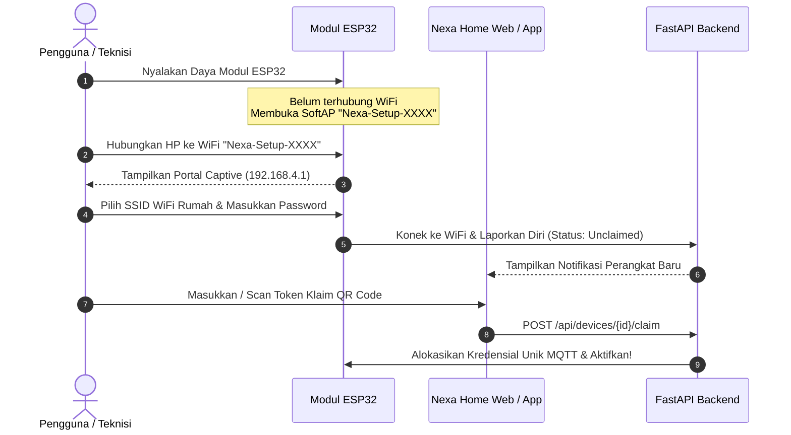

# Panduan Kamera HP Bekas & Pairing Alat ESP32

Dokumen ini memandu langkah-langkah teknis untuk memanfaatkan smartphone bekas sebagai kamera CCTV berlatensi sangat rendah, serta cara menghubungkan modul mikrokontroler ESP32 baru ke sistem Nexa Home.

---

## BAGIAN 1: Memasang Kamera CCTV dari HP Bekas

Smartphone Android atau iPhone lama Anda memiliki sensor kamera berkualitas tinggi yang jauh melampaui kamera CCTV standar murah. Dengan Nexa Home, Anda dapat menyulapnya menjadi kamera pengawas WebRTC/WHEP dengan latensi di bawah 500 milidetik.

### 1. Persiapan Perangkat Keras
1. **Smartphone Bekas:** Minimal Android 7.0 atau iOS 12 dengan kamera belakang berfungsi normal.
2. **Kabel & Adaptor Charger:** Gunakan kabel charger berkualitas baik dan adaptor 5V/1A atau 5V/2A yang stabil.
3. **Penyangga / Dudukan (Holder):** Pasang tripod mini atau dudukan dinding (*wall bracket*) di sudut ruangan yang strategis.
4. *(Tips Keamanan Baterai):* Agar baterai tidak cepat kembung karena dicas 24/7, pasang aplikasi pengontrol daya (seperti *AccuBattery* dengan batas charge 70-80%) atau colokkan charger ke stopkontak pintar Nexa Home dengan jadwal otomatis nyala-mati berkala.

### 2. Opsi Pengaliran Video (Streaming)

#### Opsi A: Menggunakan Browser Web Bawaan (WebRTC / WHEP) — Paling Mudah
1. Buka browser (Chrome / Safari) pada HP bekas.
2. Akses halaman kamera pemancar:
   ```text
   https://aujasena.my.id/kamera/broadcast
   ```
3. Berikan izin akses kamera & mikrofon saat diminta.
4. Pilih ID Kamera (misal: `cam_teras_depan` atau `cam_ruang_tamu`).
5. Letakkan smartphone pada holder. Aliran video akan langsung terhubung ke MediaMTX via WHEP secara terenkripsi.

#### Opsi B: Menggunakan Aplikasi IP Webcam (RTSP Stream)
1. Unduh aplikasi **IP Webcam** dari Google Play Store pada HP bekas.
2. Di menu *Video preferences*:
   - Resolusi: Rekomendasi `1280x720` (720p) pada 15–20 FPS (sangat stabil dan hemat CPU AI).
   - Kualitas: 50–60%.
3. Di menu *Local broadcasting*, atur username dan password login.
4. Tekan **Start server** di bagian paling bawah. Catat alamat RTSP yang muncul (contoh: `rtsp://192.168.1.150:8080/h264_pcm.sdp`).
5. Pada dashboard Nexa Home (menu **Pengaturan > Kamera > Tambah Kamera**):
   - Masukkan ID Kamera: `cam_halaman`
   - Masukkan Nama Kamera: `Kamera Teras Halaman`
   - Masukkan URL Aliran: alamat RTSP HP bekas tersebut.
6. Sistem MediaMTX backend akan otomatis menarik aliran tersebut dan menyajikannya ke web & aplikasi sebagai WebRTC instan.

---

## BAGIAN 2: Cara Pairing Modul ESP32 Baru

Setiap modul ESP32 Nexa Home dilengkapi mekanisme onboarding ramah pengguna melalui **WiFi SoftAP (Captive Portal)** dan **Klaim Token / QR Code** tanpa perlu menyambungkan kabel serial ke komputer.



### Langkah-Langkah Pairing:

#### Langkah 1: Mode SoftAP
1. Colokkan kabel daya USB ke modul ESP32.
2. Saat pertama kali dinyalakan (atau setelah tombol reset ditekan selama 5 detik), lampu indikator LED pada ESP32 akan berkedip lambat menandakan mode konfigurasi aktif.
3. ESP32 memancarkan sinyal hotspot WiFi dengan nama:
   ```text
   Nexa-Setup-XXXXXX
   ```
   *(XXXXXX adalah 6 karakter terakhir MAC address alat)*.

#### Langkah 2: Mengisi Kredensial WiFi Rumah
1. Buka pengaturan WiFi di smartphone atau laptop Anda, lalu sambungkan ke jaringan `Nexa-Setup-XXXXXX` (tanpa kata sandi).
2. Halaman portal konfigurasi (*Captive Portal*) akan otomatis terbuka. Jika tidak terbuka otomatis, buka browser dan ketik alamat IP:
   ```text
   http://192.168.4.1
   ```
3. Pada halaman konfigurasi:
   - Pilih nama jaringan WiFi rumah Anda dari daftar scan.
   - Masukkan kata sandi WiFi rumah.
   - Klik tombol **Simpan & Sambungkan**.
4. Modul ESP32 akan menyimpan konfigurasi ke memory internal (NVS) dan otomatis restart menyambung ke jaringan rumah Anda.

#### Langkah 3: Klaim Perangkat (Device Claim via QR / Token)
1. Buka aplikasi Nexa Home di ponsel atau buka [https://aujasena.my.id](https://aujasena.my.id) dari laptop Anda.
2. Masuk sebagai akun **Admin**.
3. Di halaman **Perangkat**, akan muncul lencana pemberitahuan *"Perangkat Baru Menunggu Klaim"*.
4. Klik **Klaim Perangkat Baru**:
   - Masukkan Kode Pairing / Token Klaim dari stiker modul (atau scan QR Code pada email yang dikirim sistem).
   - Berikan nama perangkat (misal: *Sakelar Lampu Dapur*).
   - Tentukan ruangan (misal: *Dapur*).
5. Klik **Konfirmasi Klaim**.
6. Server Nexa Home secara otomatis meng-generate kredensial otentikasi MQTT khusus (username & password unik yang di-hash dengan SHA-256) untuk alat tersebut.
7. Lampu LED pada ESP32 akan menyala solid tanpa berkedip. Perangkat kini aktif 100% dan siap dikontrol dari mana saja!
